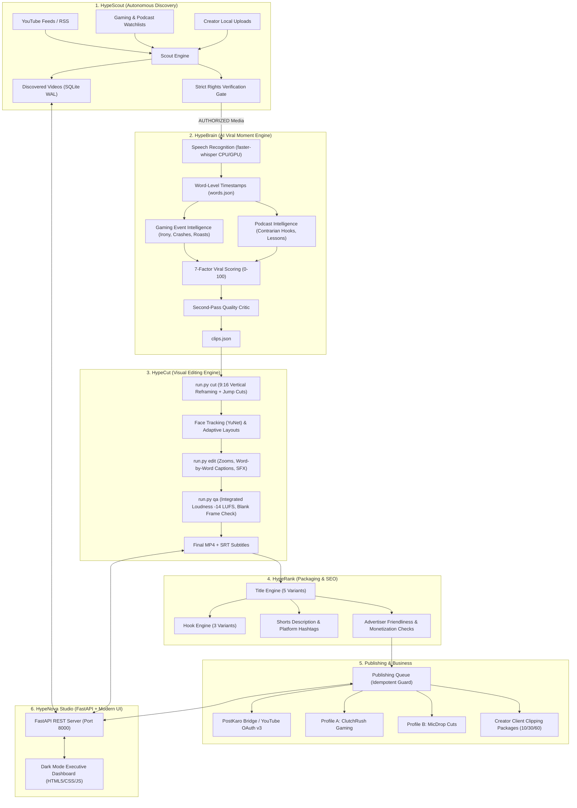

# Architecture & Open-Source Foundation
**Project**: HypeNova AI / ViralForge AI  
**Author**: Principal AI Systems Architect

---

## 1. Open-Source Benchmark & Component Evaluation

Before architectural implementation, key open-source automated video clipping frameworks were analyzed:

| Framework | Core Capabilities | Licensing | Architectural Suitability |
| :--- | :--- | :--- | :--- |
| **ClipKaro** | Word-level Whisper timestamps, Hinglish speech model, YuNet facecam tracking, 9:16 smart reframe, audio loudness normalization, `post.json` export. | **MIT** | **Primary Base Foundation**. Selected for clean local-first execution, deep Hinglish support, and proven Windows compatibility. |
| **PostKaro** | Local OAuth publishing partner for YouTube Shorts, Instagram Reels, and Facebook. Secure keyring credential storage. | **MIT** | **Primary Publishing Partner**. Accepted format via `post.json`. |
| **OpenShorts** | Cloud/local shorts generator. | Multi-licensed (Cloud directory restricted) | Reused concepts for visual preset styling; avoided cloud-licensed components. |
| **ClippyMe / ClipMint** | Transcript-based highlight selection. | GPL / MIT | Examined for prompt design and scoring heuristics. |
| **ClipsAI** | Python library for sentence-based video trimming. | MIT | Ingested algorithm ideas for non-speech pause removal. |
| **FunClip** | Alibaba speech recognition & visual editor. | Apache 2.0 | Reference for ASR alignment. |

---

## 2. System Architecture Diagram

---

## 3. What Was Reused vs. Rewritten/Created New

### Reused from ClipKaro & PostKaro
* **Audio Extraction & ASR**: `clipper.fetch` using `faster-whisper` on INT8 quantized CPU execution.
* **Computer Vision Tracking**: OpenCV YuNet face detection for portrait framing and speaker centering.
* **Jump Cut Mechanics**: Automated speech activity detection to shorten dead pauses to a natural 0.2s without cutting spoken words.
* **Caption Rendering**: Dynamic ASS subtitle generation rendered via `libass` and `libx264`.
* **PostKit Schema**: `post.json` export specification ingested by PostKaro.

### Created New in HypeNova AI
* **Modular Python Package (`hypenova/`)**: Clean package architecture decoupled from interactive chat loops.
* **Persistent SQLite Database (`hypenova/database.py`)**: WAL mode database tracking watchlists, discovered videos, rights audit logs, jobs, clips, calendar queues, analytics, and business client packages.
* **Autonomous Content Scout (`hypenova/scout/`)**: YouTube RSS and API metadata discovery with rate-limiting, deduplication, and strict rights state machine.
* **7-Factor Viral Scoring Engine (`hypenova/brain/viral_engine.py`)**: Quantitative 0–100 heuristic score with second-pass critic review.
* **Gaming & Podcast Intelligence (`hypenova/brain/`)**: Rule engines detecting streamer boasts followed by unexpected failure, sarcastic comedy, in-game crashes, and contrarian interview hooks.
* **Visual Presets (`hypenova/editor/presets.py`)**: 6 ready-to-use production presets (`GTA Chaos`, `Indian Gaming Comedy`, `Clean Podcast`, `Cinematic Gaming`, `Quick News`, `Minimal Viral`).
* **Multi-Channel Distribution (`hypenova/publisher/channel_manager.py`)**: Distinct channel profiles (`ClutchRush Gaming`, `MicDrop Cuts`) with individual limits and publish modes.
* **Persistent Daily Automation Service (`hypenova/scheduler/automation_service.py`)**: Background service running durable cycles without requiring active AI chat sessions.
* **FastAPI Backend & Interactive Dark-Mode UI (`hypenova/api/` & `hypenova/ui/`)**: Full REST API and responsive desktop dashboard.
