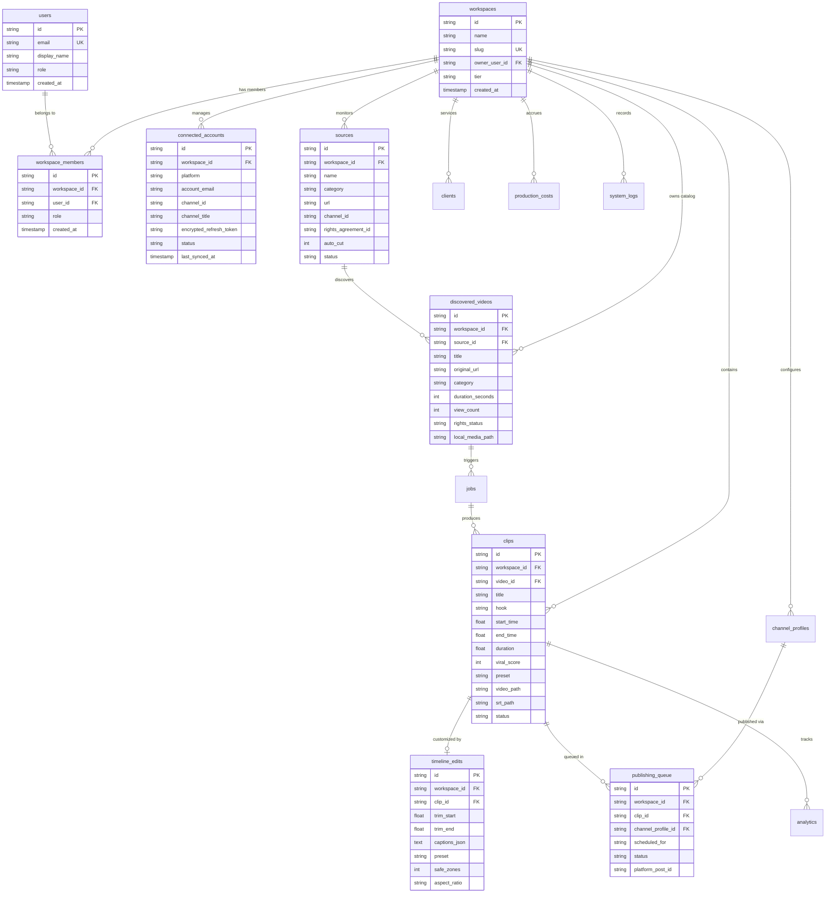

# HypeNova AI — Database Architecture & Schema Specification

## 1. Overview & Storage Engine Architecture

HypeNova AI uses a relational schema with multi-tenant isolation embedded across all primary and operational tables. 

- **Local Development / Embedded**: SQLite 3 with **WAL mode (Write-Ahead Logging)** enabled (`PRAGMA journal_mode=WAL;`), enforcing foreign keys (`PRAGMA foreign_keys = ON;`) and synchronous normal mode for high throughput.
- **Production SaaS Scaling**: Drop-in compatible with PostgreSQL 15+ using identical relational models, foreign keys, and JSONB columns for schema-less metadata.

---

## 2. Entity-Relationship (ER) Diagram

---

## 3. Detailed Table Specifications

### 1. `users`
Represents an individual authenticated user identity (managed via Firebase Auth).
- `id` (VARCHAR(64), PK): Unique user identifier (`usr-admin`, `firebase_uid`).
- `email` (VARCHAR(255), UNIQUE, NOT NULL): User email address.
- `display_name` (VARCHAR(128)): User's public full name.
- `photo_url` (TEXT): Avatar image URL.
- `role` (VARCHAR(32)): System global role (`SUPERADMIN`, `CREATOR`).
- `created_at` (TIMESTAMP): Record creation timestamp.

### 2. `workspaces`
Isolated organizational tenant boundary. Every client, agency team, or creator channel operates within a workspace.
- `id` (VARCHAR(64), PK): Unique workspace identifier (`ws-default`, `ws-clutchrush`).
- `name` (VARCHAR(128), NOT NULL): Workspace display name.
- `slug` (VARCHAR(64), UNIQUE, NOT NULL): URL-safe slug.
- `owner_user_id` (VARCHAR(64), FK -> users.id): Primary workspace owner.
- `tier` (VARCHAR(32), DEFAULT 'CREATOR'): Subscription tier (`STARTER`, `CREATOR`, `AGENCY`, `ENTERPRISE`).
- `created_at` (TIMESTAMP): Workspace creation timestamp.

### 3. `workspace_members`
Association table managing multi-user workspace access with Role-Based Access Control (RBAC).
- `id` (VARCHAR(64), PK): Unique membership ID (`mem-ws-1`).
- `workspace_id` (VARCHAR(64), FK -> workspaces.id, CASCADE).
- `user_id` (VARCHAR(64), FK -> users.id, CASCADE).
- `role` (VARCHAR(32), NOT NULL): Role within this workspace (`OWNER`, `EDITOR`, `VIEWER`).
- `created_at` (TIMESTAMP): Association timestamp.

### 4. `connected_accounts`
External channel integrations authorized via OAuth 2.0.
- `id` (VARCHAR(64), PK): Account integration ID (`yt-acc-UC123...`).
- `workspace_id` (VARCHAR(64), FK -> workspaces.id, CASCADE).
- `platform` (VARCHAR(32), NOT NULL): Platform name (`youtube`, `instagram`, `tiktok`).
- `account_email` (VARCHAR(255)): Google email of authorized channel owner.
- `channel_id` (VARCHAR(128), NOT NULL): Platform channel identifier.
- `channel_title` (VARCHAR(255), NOT NULL): Display title of the channel.
- `channel_thumbnail` (TEXT): Channel avatar thumbnail URL.
- `scopes_granted` (TEXT): JSON array of authorized OAuth scopes.
- `encrypted_refresh_token` (TEXT): AES-256-GCM encrypted OAuth 2.0 refresh token.
- `status` (VARCHAR(32), DEFAULT 'CONNECTED'): Connection state (`CONNECTED`, `EXPIRED`, `REVOKED`).
- `last_synced_at` (TIMESTAMP): Last API verification timestamp.

### 5. `sources`
Monitored YouTube channels, playlists, or directories.
- `id` (VARCHAR(64), PK): Source identifier.
- `workspace_id` (VARCHAR(64), FK -> workspaces.id, CASCADE).
- `name` (VARCHAR(128), NOT NULL): Creator or playlist name.
- `category` (VARCHAR(64)): Content category (`gaming`, `podcast`, `news`).
- `url` (TEXT, NOT NULL): Canonical YouTube channel or playlist URL.
- `channel_id` (VARCHAR(64)): YouTube channel ID.
- `rights_agreement_id` (VARCHAR(64)): Contract or license identifier clearing processing rights.
- `auto_cut` (INTEGER, DEFAULT 0): Boolean (1 = auto-extract highlights on discovery).
- `status` (VARCHAR(32), DEFAULT 'ACTIVE'): Source polling state.

### 6. `discovered_videos`
Catalog of discovered media opportunities with strict rights lifecycle tracking.
- `id` (VARCHAR(64), PK): Discovered item ID.
- `workspace_id` (VARCHAR(64), FK -> workspaces.id, CASCADE).
- `source_id` (VARCHAR(64), FK -> sources.id).
- `title` (TEXT, NOT NULL): Original video title.
- `original_url` (TEXT, NOT NULL): External reference URL.
- `channel_title` (VARCHAR(128)): Creator channel name.
- `category` (VARCHAR(64)): Gaming, Podcast, Interview, etc.
- `duration_seconds` (INTEGER): Total media duration.
- `view_count` (INTEGER): Public view metrics at discovery.
- `published_at` (TIMESTAMP): Original publication date.
- `rights_status` (VARCHAR(32), NOT NULL): `SOURCE_REQUIRED`, `RIGHTS_REVIEW`, `AUTHORIZED`, `BLOCKED`.
- `rights_notes` (TEXT): Legal audit notes or permission grant details.
- `local_media_path` (TEXT): Path to locally downloaded/uploaded authorized media.

### 7. `clips`
Extracted and rendered 9:16 vertical short-form video products.
- `id` (VARCHAR(64), PK): Clip identifier (`clip-01`).
- `workspace_id` (VARCHAR(64), FK -> workspaces.id, CASCADE).
- `video_id` (VARCHAR(64), FK -> discovered_videos.id).
- `title` (VARCHAR(255), NOT NULL): Clip title.
- `hook` (TEXT, NOT NULL): Opening 3-second verbatim hook.
- `start_time` (FLOAT, NOT NULL): In-Point timestamp in seconds.
- `end_time` (FLOAT, NOT NULL): Out-Point timestamp in seconds.
- `duration` (FLOAT, NOT NULL): Total rendered duration.
- `viral_score` (INTEGER, NOT NULL): 7-factor viral prediction score (0–100).
- `score_breakdown` (TEXT): JSON containing sub-scores (hook, pacing, emotion, punchline, etc.).
- `preset` (VARCHAR(64)): Editing preset applied.
- `video_path` (TEXT): Absolute path to rendered MP4.
- `srt_path` (TEXT): Absolute path to ASS/SRT caption subtitle file.
- `post_metadata` (TEXT): JSON package containing 5 title variants, tags, and description.
- `status` (VARCHAR(32), DEFAULT 'EDITED'): Lifecycle status (`GENERATED`, `EDITED`, `APPROVED`, `SCHEDULED`, `PUBLISHED`).

### 8. `timeline_edits`
Stores non-destructive multi-track video editor states (In/Out points, caption blocks, presets).
- `id` (VARCHAR(64), PK): Edit session ID (`edit-clip-01`).
- `workspace_id` (VARCHAR(64), FK -> workspaces.id, CASCADE).
- `clip_id` (VARCHAR(64), FK -> clips.id, CASCADE).
- `trim_start` (FLOAT, NOT NULL): Adjusted In-Point in seconds.
- `trim_end` (FLOAT, NOT NULL): Adjusted Out-Point in seconds.
- `captions_json` (TEXT, NOT NULL): Array of `{id, start, end, text}` subtitle blocks.
- `preset` (VARCHAR(64), NOT NULL): Active visual preset.
- `safe_zones` (INTEGER, DEFAULT 1): Safe zone guides enabled (1/0).
- `aspect_ratio` (VARCHAR(16), DEFAULT '9:16'): Aspect ratio ('9:16' or '16:9').
- `updated_at` (TIMESTAMP): Last saved draft timestamp.

### 9. `channel_profiles`
Internal publishing channel personas and frequency policies.
- `id` (VARCHAR(64), PK): Profile ID (`chan-clutchrush`, `chan-micdrop`).
- `workspace_id` (VARCHAR(64), FK -> workspaces.id, CASCADE).
- `name` (VARCHAR(128), NOT NULL): Channel display persona.
- `platform` (VARCHAR(32), DEFAULT 'youtube'): Platform target.
- `target_audience` (TEXT): Audience demographics and linguistic guidelines.
- `posting_schedule` (VARCHAR(128)): Cron or cadence string (e.g., `daily_1800_ist`).
- `default_preset` (VARCHAR(64)): Visual preset assigned to this channel.
- `status` (VARCHAR(32), DEFAULT 'ACTIVE'): Channel scheduling state.
- `max_daily_posts` (INTEGER, DEFAULT 2): Safeguard daily cap to prevent spam flags.

### 10. `publishing_queue`
Idempotent scheduling and distribution queue.
- `id` (VARCHAR(64), PK): Queue entry ID.
- `workspace_id` (VARCHAR(64), FK -> workspaces.id, CASCADE).
- `clip_id` (VARCHAR(64), FK -> clips.id).
- `channel_profile_id` (VARCHAR(64), FK -> channel_profiles.id).
- `scheduled_for` (TIMESTAMP, NOT NULL): Target release time.
- `status` (VARCHAR(32), DEFAULT 'QUEUED'): `QUEUED`, `UPLOADING`, `PUBLISHED`, `FAILED`.
- `platform_post_id` (VARCHAR(128)): External video ID returned by YouTube upon upload.
- `error_log` (TEXT): Detailed error trace if upload rejected.

### 11. `analytics`
Authenticated performance metrics and format research benchmarks.
- `id` (VARCHAR(64), PK): Analytics record ID.
- `workspace_id` (VARCHAR(64), FK -> workspaces.id, CASCADE).
- `clip_id` (VARCHAR(64), FK -> clips.id).
- `platform` (VARCHAR(32), DEFAULT 'youtube'): Platform origin.
- `data_type` (VARCHAR(32), NOT NULL): `OBSERVED` (real YouTube API response) vs `BENCHMARK` (experimental benchmark).
- `views` (INTEGER, DEFAULT 0): Total view count.
- `likes` (INTEGER, DEFAULT 0): Total like count.
- `comments` (INTEGER, DEFAULT 0): Total comment count.
- `shares` (INTEGER, DEFAULT 0): Total share count.
- `retention_pct` (FLOAT, DEFAULT 0.0): Average percentage viewed.
- `revenue_inr` (FLOAT, DEFAULT 0.0): YouTube partner earnings in INR.
- `recorded_at` (TIMESTAMP): Sync timestamp.

### 12. `clients` & `production_costs`
B2B creator agency CRM and compute energy telemetry.
- `clients`: Tracks client retainers, clip quotas, and contract renewals.
- `production_costs`: Tracks exact CPU/GPU execution time in seconds, estimated electricity kWh consumption, and cost per clip in INR (₹2.50 per rendered short).
